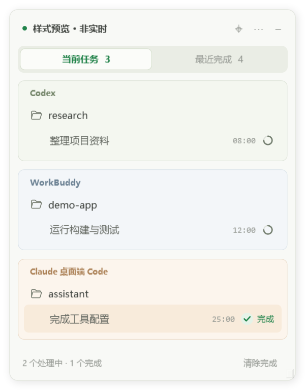
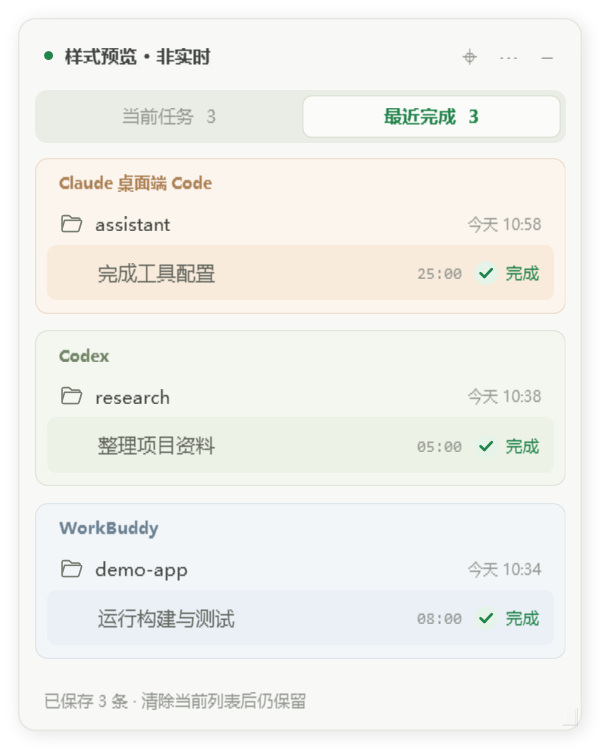

# 一泽的 AI Agent 任务监控

独立的 Windows 悬浮小软件。支持 **Codex / WorkBuddy / Claude 桌面端 Code**，可勾选监控平台；以项目分组展示当前对话，开始执行自动加入，运行中转圈并实时计时，本轮完成变绿并提醒，点击标题打开对应平台的对话。

顶部提供 **当前任务 / 最近完成** 两个标签页。完成记录独立保存最近 200 条，清除当前列表、继续提问、取消平台勾选或重启软件，都不会删除已保存的完成记录。

两个列表均保存到本地。软件启动后先恢复当前列表，再检查平台数据和运行进程；无法确认仍在执行的任务显示「待确认」，不会沿用关机前的转圈状态。设置中启用「开机自动启动」后，登录 Windows 时自动恢复并检测。

「最近完成」按会话只显示最后一次完成记录。点击文件夹名称可折叠或展开，折叠状态会在刷新、切换标签和重启后保留。

不同平台使用独立的浅色圆角分区，平台名只在区域左上角显示一次；区域内保留简洁的项目与对话列表。

Codex 使用浅绿色，WorkBuddy 使用浅蓝色，Claude Code 使用浅橙色。任务行与悬停底色保持所属平台的色系，绿色完成标记保留。





## 使用

从 [Releases](https://github.com/YizeAINative/yize-codex-monitor/releases/latest) 下载便携压缩包，解压后双击 `CodexFloat.exe`。源码构建后也可以运行 `dist/CodexFloat.exe`。无需安装 Python、Node.js 或插件。程序使用 Windows 自带的 .NET Framework 桌面组件，已在 Windows 11 上验证。

- **运行中**：右侧转圈。
- **本轮计时**：转圈左侧每秒更新运行时间，如 `03:28` / `01:03:28`；完成后冻结，继续提问进入新一轮时重置。
- **状态检查**：启动时立即检查一次，此后每 20 秒读取一次各平台本地日志或状态数据；任务开始、完成和提醒通常在下一次检查时更新，界面计时仍每秒刷新。
- **本轮完成**：绿色勾选和完成文字，弹出一次提醒并播放提示音。完成项一直保留到手动清除。
- **继续提问**：同一个对话自动回到转圈，下一轮完成再次提醒。
- **最近完成**：按平台分区，同一文件夹只显示一个可折叠标题，组内按完成时间倒序排列。每个会话只显示最新一次完成，后续完成会更新这条记录。不同会话即使名称相同也分别显示。每条记录显示 `MM-dd HH:mm` 格式的完成时间、本轮用时和对话标题，点击可打开对应对话。
- **已中断**：明确显示中断，不发送完成提醒。
- **待确认**：缺少明确结束事件且无法确认仍有写入进程，不误标完成。
- **点击标题**：Codex / WorkBuddy 通过应用链接打开对应对话；Claude 桌面端 Code 通过 `claude://claude.ai/epitaxy/local_<ID>` 打开桌面端对应会话，不启动命令行。
- **拖动顶部**：按住顶部标题栏的空白区域或名称都可以移动窗口；置顶、设置、收起按钮仍正常点击。右下角可调整宽度。
- **右上角三个点**：勾选 Codex / WorkBuddy / Claude Code，以及置顶、声音、弹出提醒、测试提醒、重置位置、开机启动、退出。取消平台勾选后停止该平台读取、隐藏其条目并停止提醒；重新勾选不补播暂停期间的完成通知。
- **右上角减号**：收起到系统托盘。双击托盘图标或再次启动 EXE 即可找回。
- **清除完成**：只移出当前任务列表中已结束的行；成功完成的记录继续保留在「最近完成」，不会删除平台的聊天或文件。
- **单独加入完成**：在「当前任务」中右键已完成的会话名称，选择「加入完成」，会保存到最近完成并只移出这一条。运行中、等待中或尚未确认完成的任务不会被此操作标记为成功。单条移出状态会保存，重启不重复出现；新一轮提问仍会自动重新加入。

绿色表示当前执行轮次已经结束，并不代表整个项目的业务目标已经完成。

## 数据与工作方式

默认监控 `%USERPROFILE%\.codex`，也支持 `CODEX_HOME` 环境变量。

WorkBuddy 自动发现 `%USERPROFILE%\.workbuddy-ai\workbuddy.db` 或 `%USERPROFILE%\.workbuddy\workbuddy.db`，也支持 `WORKBUDDY_HOME`。使用 Windows 自带 SQLite 组件以只读模式读取标题、项目路径、状态和时间元数据，不读取消息正文。在 WorkBuddy 5.3.14 的本地数据结构上核对。

WorkBuddy 的 `planning` / `working` 显示转圈，`pending` 显示等待输入，`completed` 变绿，`terminated` 显示中断，`error` / `failed` 显示失败。初次运行不列出所有历史完成任务。若首次接入时 WorkBuddy 任务已经在执行，只能从最近的状态时间估计起点，计时前显示 `≈`；之后观察到的新轮次正常重新计时。

Claude 仅监控桌面端 **Code**，不监控普通 Chat、Cowork 或独立命令行任务。自动发现 `%LOCALAPPDATA%\Claude-Data\claude_*`、MSIX 的 `LocalCache\Roaming\Claude`、`%APPDATA%\Claude` 和 `%LOCALAPPDATA%\Claude-3p` 中的 `claude-code-sessions` 索引；可用 `CLAUDE_DESKTOP_HOME` 或 `--claude-home` 指定桌面端数据根目录。索引提供桌面会话 ID、标题和工作目录，仅跟踪索引关联的 `%USERPROFILE%\.claude\projects` 状态日志（此目录仍支持 `CLAUDE_CONFIG_DIR`）。不读取登录凭据，不修改 Claude 文件。

Claude 首次接入每个日志只读取末尾最多 **256 KiB**，跳过首个不完整 JSON 行，保留恰好位于边界的完整行；之后按文件偏移只读取新增字节，每轮最多 256 KiB。文件被截短时也从新的尾部恢复，不回读整段历史。仅提取生命周期字段，不保存消息正文。标题来自桌面端索引，历史结束任务不补发提醒。尾部没有本轮起点时用桌面端最新提问时间估算计时，并显示 `≈`；不会让早于该次提问的结束事件将新一轮误标完成。桌面端日志若未落地或尾部缺少明确状态，不凭空判定完成。桌面端打开本身不代表 Code 正在执行；使用桌面端派生的工作进程辅助判断。

Claude 适配状态单独保存在 `%LOCALAPPDATA%\CodexFloat\claude-desktop-code`，不会继承旧命令行监控列表。已用隔离夹具验证桌面端身份映射、命令行过滤、精确跳转链接、多轮通知、开关恢复、中断、清除与大文件限量读取。

程序仅在本机工作，没有网络请求，不调用模型，不读取登录凭据，不修改 Codex 配置和会话文件。读取来源为：

- `sessions/**/*.jsonl` 的会话身份和生命周期事件；通过目录监听和增量读取更新状态。
- `session_index.jsonl` 的对话标题。
- `.codex-global-state.json` 中的项目名称与对话归属。

自动忽略内部子代理。监控整个会话目录，因此早期日期创建的旧对话恢复执行也能识别。每轮检查后等待 20 秒再读取各平台状态；Codex 在检查时同时补查目录和已发现对话的文件大小（包括已完成项），避免 Windows 延迟文件变化通知时漏掉下一轮提问。文件变化通知只标记待检查文件，由下一轮统一读取。未监控过的历史完成对话不会在首次启动时集中弹提醒。

本软件自己的设置、列表状态及简要诊断保存在 `%LOCALAPPDATA%\CodexFloat`，完成提醒按对话与执行轮次去重。

当前列表保存于 `current-tasks.json`，包含最近检查的任务快照和单轮移出标记，采用原子保存与上一版备份。平台暂未启动、数据暂时不可读时保留缓存条目；恢复连接后重新核对状态。明确的结束事件会更新为完成，缺少运行依据时保留为待确认。移出标记只针对当前轮次，不会永久屏蔽整个会话。

完成历史保存在独立的 `completion-history.json`，采用原子保存并保留上一版备份。升级时会从本工具仍保留的缓存中恢复已有完成项，包括已从当前列表清除的记录；不扫描平台完整聊天历史。缓存已经覆盖或丢失的更早轮次无法追溯补全。历史页不受监控平台开关影响，只保留最近 200 条成功完成记录。

界面在这些记录中按「平台 + 会话 ID」选择最近完成的一条，因此重复提问不会让同一会话占据多行；已有较早轮次只是不重复展示。文件夹折叠偏好保存在本软件的 `settings.json`。

“开机自动启动”仅在用户勾选时设置当前用户的 `HKCU\Software\Microsoft\Windows\CurrentVersion\Run\CodexFloat`。关闭该选项即可取消。便携版启用后请保持 EXE 路径稳定。

本工具当前针对本地 Codex / WorkBuddy / Claude Code 会话。云端或其他电脑未落地到本机的会话不在监控范围。若平台后续改变本地日志或数据库格式，可能需要更新读取逻辑。无法明确识别的状态保持“待确认”。

## 构建与验证

源文件：`Core.cs`（Codex 生命周期、增量读取、目录监听、持久化和计时），`WorkBuddy.cs`（WorkBuddy 只读 SQLite 适配器、状态机及平台监控调度），`Claude.cs`（限量读取状态事件与状态机）、`ClaudeDesktop.cs`（桌面端索引、会话筛选和桌面跳转），`Current.cs`（统一当前列表、恢复与移出标记），`History.cs`（独立完成历史、去重、缓存迁移与备份），`App.cs`（WPF 标签页、悬浮窗、菜单、托盘、提醒及对话跳转）。

```powershell
.\build.ps1
.\dist\CoreTests.exe
.\dist\UiTests.exe
```

使用本机 .NET Framework 编译器，无 NuGet 或 npm 依赖。`CoreTests.exe` 在独立临时目录运行，不修改真实 Codex 数据。

已通过 162 项核心检查和 12 项 WPF 界面交互检查。覆盖列表持久化、启动复核、进程不可用、离线期间完成、单条加入完成、移出后重启不重复、新轮次重新加入、历史去重、备份恢复与文件夹折叠。界面检查实际触发菜单与按钮事件，验证只移出选中条目及保留最近完成。测试使用隔离数据，不重启电脑或修改用户会话。

开发诊断参数：

```powershell
# 仅输出一次本地状态，使用独立诊断目录
.\dist\CodexFloat.exe --dump --data-dir .\test-data\dump --output .\test-data\snapshot.json

# 使用隔离的测试会话目录
.\dist\CodexFloat.exe --home C:\path\to\fixture --data-dir C:\path\to\test-state
```

`--demo` 是标注“样式预览 · 非实时”的固定示例界面，仅供开发验图；正式快捷方式与正常启动不使用该参数。

## 参考

状态采集思路与对话链接格式参考 [Agent Monitor HUD](https://github.com/LH-03/agent-monitor-hud) 及其[架构说明](https://github.com/LH-03/agent-monitor-hud/blob/main/docs/ARCHITECTURE.md)。本程序独立实现简洁列表与状态机，未依赖或安装该项目。本地研究资料、真实会话数据和测试运行记录不包含在本仓库内。

非官方工具，与 OpenAI、腾讯、Anthropic 无关联。
